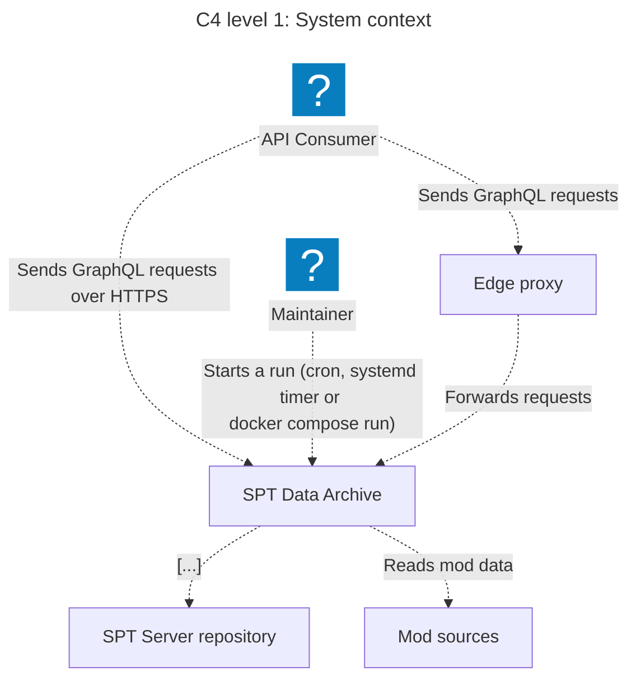
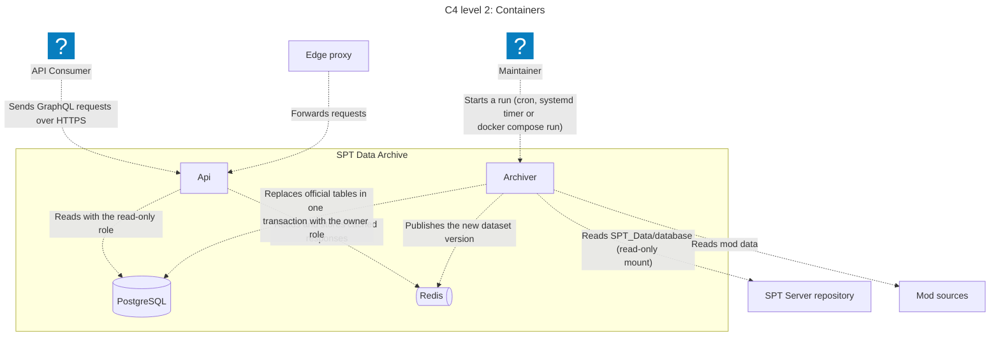
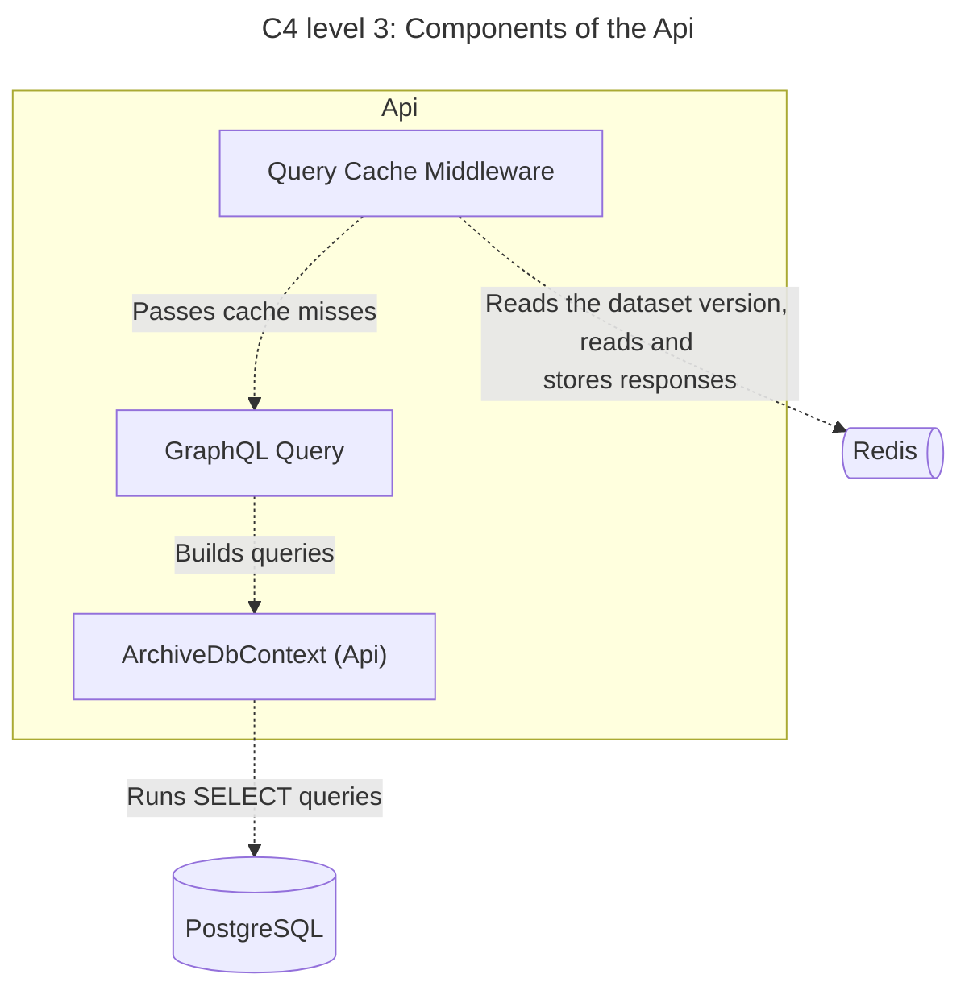
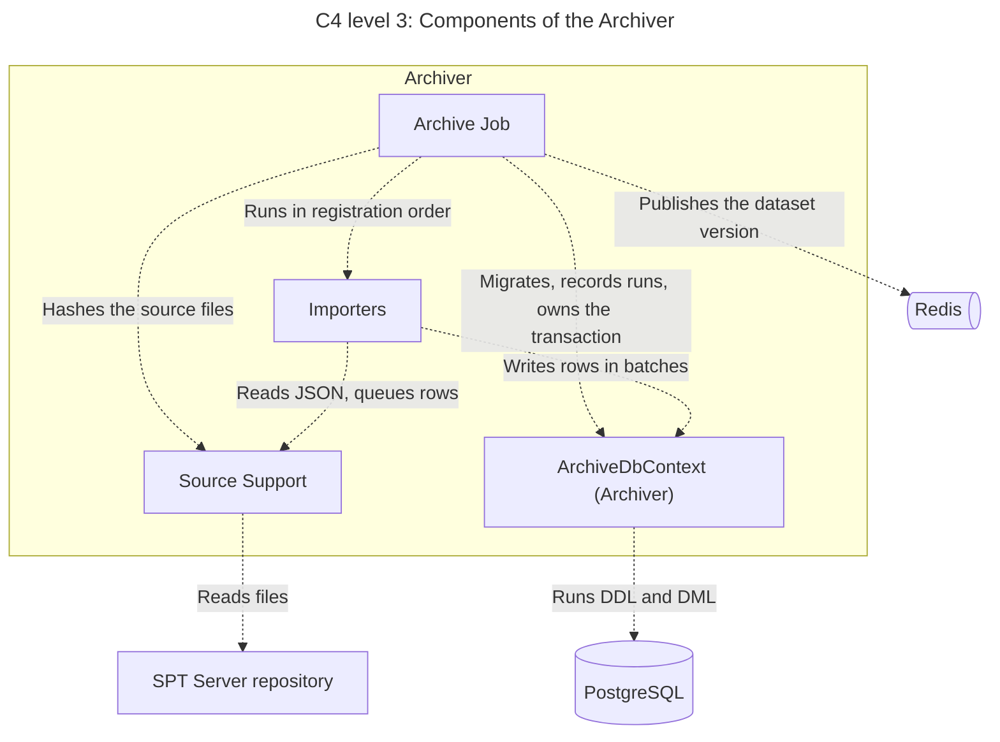
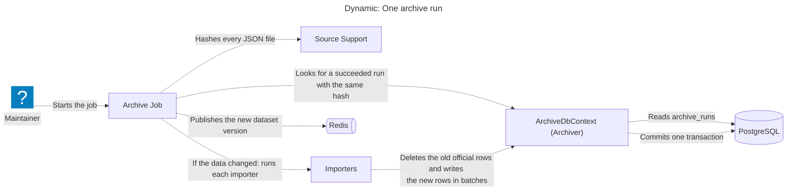
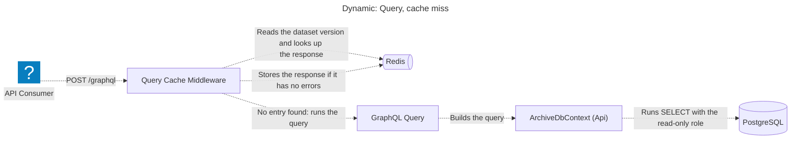
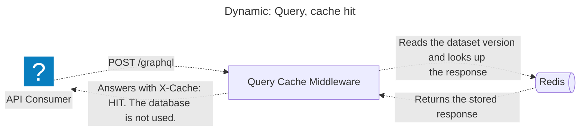
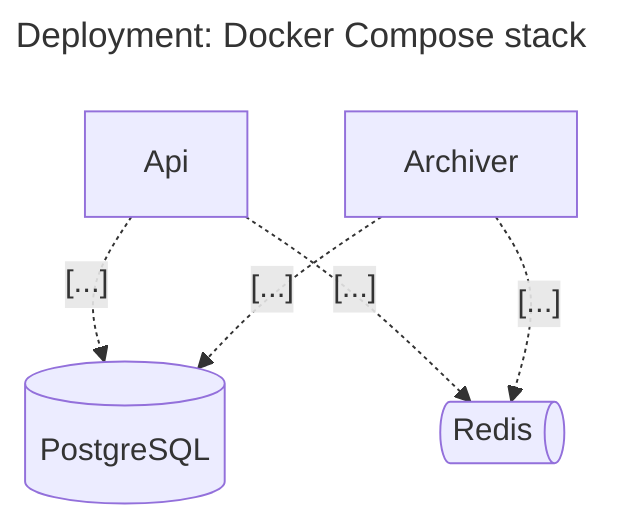

# C4 diagrams

> Generated from `c4/*.c4` by `generate-diagrams.sh`. Do not edit this file. Edit the model and run the script again.

> The elements "Mod sources" and "Edge proxy" are tagged `planned` in the model. They are not built yet. Mermaid does not show the tag. Use `npx likec4 start` to see it.

## C4 level 1: System context

View: `index`

## C4 level 2: Containers

View: `containers`

## C4 level 3: Components of the Api

View: `apiComponents`

## C4 level 3: Components of the Archiver

View: `archiverComponents`

## Dynamic: One archive run

View: `archiveRun`

## Dynamic: Query, cache miss

View: `queryCacheMiss`

## Dynamic: Query, cache hit

View: `queryCacheHit`

## Deployment: Docker Compose stack

View: `production`

